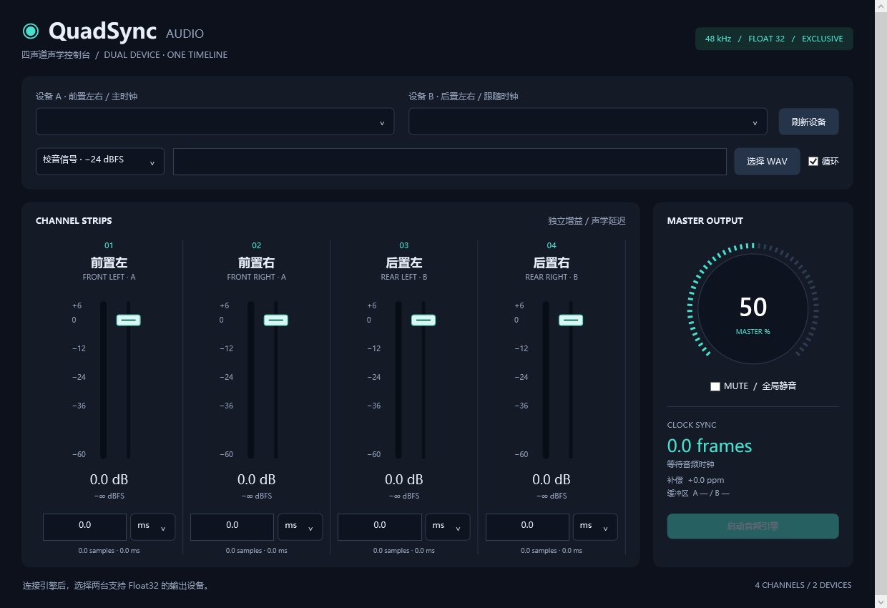
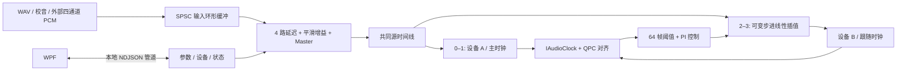

# QuadSyncAudio

面向 Windows 10/11 x64 的四声道音频路由与声学校准工具。C++20 引擎通过 **WASAPI 独占、事件驱动模式**控制两台独立声卡，C# / WPF（.NET 8）提供实时控制界面，两者使用本地命名管道交换 JSON。



## 功能

| 模块 | 实现 |
| --- | --- |
| 双设备输出 | 枚举活动播放端点、检测格式支持；A 接收通道 0–1，B 接收通道 2–3 |
| 固定输出格式 | 每台设备 Stereo / 48,000 Hz / IEEE Float32 / WASAPI Exclusive |
| 四路 DSP | 每声道 0–100 ms 延迟、距离换算、分数采样插值、−60 至 +6 dB 增益 |
| 平滑调节 | 增益与总音量采用 10 ms 时间常数的一阶低通；延迟切换采用 10 ms 双读头交叉淡化 |
| 总线控制 | 0–100% 线性 Master 音量、全局平滑静音、输出削波计数 |
| 时钟补偿 | 共同 QPC 时间基准、播放位置映射、64 帧触发、PI 控制、B 路线性重采样 |
| 桌面控制 | 深色界面、四路 Peak Meter、垂直推子、ms/m 输入、大尺寸交互旋钮 |
| 音源 | 内置四音校准信号、WAV 播放、C++ 四通道写入接口、JSON PCM 接口 |
| 状态与配置 | 20 Hz 电平刷新、补偿 ppm、缓冲区大小、补零/削波计数；本地保存设置 |

## 快速使用

1. 从仓库的 **Releases** 下载 Windows x64 压缩包，或从 **Actions → Windows build and tests → Artifacts** 下载构建产物。解压整个目录后启动 `QuadSync.Control.exe`。默认发布包自带 .NET 运行时。
2. 在设备 A、B 中选择两台不同的物理输出声卡。引擎会拒绝重复端点；驱动提供有效 Container ID 时，也会拒绝同一物理设备的两个端点。
3. 选择校音信号或 WAV，点击「启动音频引擎」。四路校音频率为 440、550、660、880 Hz，源电平为 −24 dBFS，默认 Master 为 50%。
4. 调节推子；延迟框输入一位小数，失去焦点时提交。切换 `ms` / `m` 会换算显示，保留内部精度。旋钮支持上下拖动、滚轮、方向键；Home/End 对应 0%/100%。
5. 点击「停止输出」释放独占设备。关闭面板时会结束由该面板启动的后台引擎。

**声卡必须原生支持上述独占 Float32 格式。** 支持 Windows 共享模式 Float32 不等于支持独占 Float32。下拉框会标记不兼容端点，本项目不自动切换为共享模式或整数 PCM。若启动报独占权限/设备占用错误，请在 Windows「声音 → 设备属性 → 高级」开启独占模式，并关闭占用该设备的程序。

支持的 WAV：48 kHz、2 或 4 声道、IEEE Float32 或整数 PCM16/24/32（含有效位数等于容器位数的 WAVE_FORMAT_EXTENSIBLE）。四声道文件按存储顺序映射；双声道文件将 L/R 同时复制至前后两组。距离输入代表**增加的延迟距离**，不是自动测距；按扬声器距离补偿时，较近扬声器应增加 `最远距离 − 当前距离` 对应的延迟。

## 构建

需要：Windows 10/11 x64、CMake 3.24+、Visual Studio 2022 的「使用 C++ 的桌面开发」（含 Windows SDK）、.NET 8 SDK。

```powershell
git clone https://github.com/AzureLong64/QuadSyncAudio.git
cd QuadSyncAudio
powershell -ExecutionPolicy Bypass -File scripts/build.ps1
.\dist\QuadSync.Control.exe
```

构建脚本执行 CMake 配置、C++ 编译、核心测试、WPF 自包含发布，并将后台程序复制到 `dist`。`-FrameworkDependent` 可生成依赖已安装 .NET 8 Desktop Runtime 的较小包。

也支持 LLVM-MinGW + Ninja。手动构建示例：

```powershell
cmake -S . -B build -G Ninja -DCMAKE_CXX_COMPILER=clang++ -DCMAKE_BUILD_TYPE=Release
cmake --build build
ctest --test-dir build --output-on-failure
dotnet publish desktop/QuadSync.Control -c Release -r win-x64 --self-contained true -o dist --configfile NuGet.Config
Copy-Item build/QuadSync.Engine.exe dist/
```

编译器、CMake、Ninja 应位于 PATH；切换编译器时使用不同构建目录。JSON 解析器 nlohmann/json 3.12.0 已附带在 `native/third_party`，无需联网拉取 C++ 依赖。WPF 使用平台组件，无第三方 UI 包。

## 项目结构

```text
native/include/quadsync/  引擎公共 API、DSP、环形缓冲、漂移控制器
native/src/              WASAPI 输出、音源读取、管道服务、后台入口
native/third_party/      nlohmann/json 及许可证
desktop/QuadSync.Control/ WPF 控制面板
tests/core_tests.cpp     DSP、分流、并发环形缓冲与漂移仿真测试
scripts/build.ps1       构建、测试与打包
scripts/test-pipe.ps1   真实进程间管道集成测试
docs/                   界面截图、协议说明
```

## 音频管线



单个 MMCSS `Pro Audio` 线程等待两台设备各自的音频事件和停止事件，交替服务 A、B。COM 对象在该线程内创建和释放；实时处理循环使用预分配缓冲，不执行文件读取、JSON 解析或控制锁操作。WAV 读取在启动前完成，PCM 音源通过独立生产线程输入。

独占事件模式每次提交设备要求的**完整缓冲区**，不是按共享模式的 `GetCurrentPadding` 分块写入。请求周期默认 10 ms，遵守设备最小周期，并处理 `AUDCLNT_E_BUFFER_SIZE_NOT_ALIGNED`：获取对齐帧数，重新激活 `IAudioClient`，按对齐后的相同周期/时长初始化。每台设备分别使用驱动返回的帧数。

### DSP 公式

距离与延迟：

```text
delay_ms = distance_m / 343 × 1000
delay_samples = delay_ms × 48000 / 1000
```

例如 3.43 m → 10 ms → 480 帧；100 ms → 4800 帧。内部保留分数采样位置，使用环形延迟线及线性插值。显示一位小数不限制内部计算精度。

增益、Master 和静音：

```text
target_gain = 10^(gain_dB / 20)
alpha = 1 − exp(−1 / (0.010 × 48000))
gain[n] = gain[n−1] + alpha × (target_gain − gain[n−1])
master[n] = master[n−1] + alpha × (target_master − master[n−1])
output[ch,n] = delayed_input[ch,n] × gain[ch,n] × master[n]
```

Master 的控制域是线性振幅 `[0,1]`；Mute 将 Master 的目标置零，取消静音后恢复旋钮值。增益和平滑状态使用双精度累加，最终输出为 Float32。输出超出 `[-1,1]` 时进行硬限幅，并累计削波样本，便于降低输入或总增益。

### 多设备时钟同步

1. 读取两台设备的 `IAudioClock::GetPosition` 与对应 QPC 时间戳，通过各自 `GetFrequency` 换算成设备输出帧；QPC 返回值单位为 100 ns。
2. 外推至同一 QPC 时刻，并通过每个已提交块的 `(outputStart, sourceStart, frameCount, step)` 历史映射还原正在播放的**源帧位置**。已排队音频使用该块实际使用的重采样比例，避免拿当前比例重算旧块。
3. `lag = playedSourceA − playedSourceB`。正值表示 B 落后，应增加 B 的读取步进；负值表示 B 超前，应减小步进。共同写指针减各自播放位置得到排队帧数，两者之差即 Buffer Lag。
4. 对测量值作 100 ms 一阶滤波。绝对值超过 64 帧时激活 PI 控制，比例增益 `2e−5`、积分增益 `2e−6/s`，B 步进限制为 `[0.998,1.002]`，变化速率限制为 500 ppm/s。
5. 激活后保持积分补偿，接近零误差时仍可抵消持续的晶振频差。B 的两个声道使用同一分数位置和步进，维持该设备内部左右同步。A 始终使用步进 1。

面板上的帧差是软件播放时间线的估计。48 kHz 的一帧约为 **20.83 µs**，64 帧约为 **1.33 ms**。这一算法用于抑制独立时钟的长期漂移；物理声学相位还包含驱动、DAC、启动和传播延迟。需要跨声卡微秒级物理相位保证时，应使用共享硬件时钟/同一多通道接口，并通过测量校准固定路径延迟。

## 接入自己的 PCM 生产者

`WasapiEngine` 是可复用的 C++ 管理类，CMake 目标为 `quadsync_engine`：

```cpp
#include <quadsync/WasapiEngine.hpp>

quadsync::WasapiEngine engine;
auto devices = quadsync::WasapiEngine::EnumerateDevices();
// 从 devices 中选择两个不同物理设备，且 float48 为 true。
engine.Start(deviceAId, deviceBId);
engine.controls.setChannel(0, -3.0, 10.0); // 声道、dB、ms
engine.controls.master = 0.5f;

// pcm: [FL, FR, RL, RR, FL, FR, RL, RR, ...]，48 kHz Float32
size_t written = engine.WriteInterleaved(pcm, frameCount);
// 非阻塞：返回已接收的帧数。未接收的部分由生产者保留并重试。
// 不要丢弃 pcm + written * 4 之后的数据。

// 先停止并 join 生产线程，再停止/重启引擎。
engine.Stop();
```

输入缓冲容量为 16,384 帧。`WriteInterleaved` 是 **单生产者** 接口；控制线程与生产者应遵守头文件中的启动/停止约束。外部输入应保持与 A 消耗速率一致：根据可写空间补充小块音频，不以固定 `sleep` 作为采样时钟。没有输入时引擎继续输出零值，并累计补零帧；启动预填充也计入该计数。

命名管道接口、完整消息示例及外部 PCM 用法见 [协议文档](docs/protocol.md)。`--list` 可直接枚举端点：

```powershell
.\dist\QuadSync.Engine.exe --list
```

## 测试

```powershell
ctest --test-dir build -C Release --output-on-failure
powershell -ExecutionPolicy Bypass -File scripts/test-pipe.ps1 -Engine .\dist\QuadSync.Engine.exe
```

核心测试验证脉冲定位、100 ms 极值、0.1 ms 分数延迟、每声道增益隔离、Master/静音平滑、环形缓冲的跨线程顺序、重采样及播放映射。漂移仿真运行四组 ±100 / ±500 ppm 独立时钟，每组模拟 10 分钟，检查补偿方向、64 帧触发、步进限制和最终误差。

管道测试启动真实后台进程，验证设备枚举、参数校验、错误恢复、UTF-8 JSON 行分帧、PCM 帧校验、重连和关闭，不占用音频设备。GitHub Actions 在 Windows 上使用 MSVC 编译、执行这些测试并渲染 WPF 界面，上传完整运行目录。

实际双声卡验证需准备两台支持目标格式的设备：用四通道 WAV 核对通道分流，用脉冲测量延迟，用长时间连续信号观察 Lag、补偿 ppm 与补零计数；物理相位测量应同时采集两台声卡的模拟输出。

## 设置与协议位置

- 本地配置：`%LOCALAPPDATA%\QuadSyncAudio\settings.json`，保存设备 ID、增益、延迟单位、Master、静音和音源设置。
- 管道：`\\.\pipe\QuadSyncAudio.v1`，限当前 Windows 用户、本机连接。每次仅接收一个控制客户端；测试可通过 `--pipe` 使用独立管道名。
- 设备失效、事件超时或同步历史耗尽时，两台输出共同停止，错误显示在面板底部。恢复连接后刷新设备并重新启动。

## 实现参考

- [Microsoft：IAudioClient::Initialize](https://learn.microsoft.com/en-us/windows/win32/api/audioclient/nf-audioclient-iaudioclient-initialize)
- [Microsoft：IAudioClock::GetPosition](https://learn.microsoft.com/en-us/windows/win32/api/audioclient/nf-audioclient-iaudioclock-getposition)
- [Microsoft：Exclusive-Mode Streams](https://learn.microsoft.com/en-us/windows/win32/coreaudio/exclusive-mode-streams)

项目采用 MIT 许可证。nlohmann/json 的许可证见 `native/third_party/LICENSE.json`；发布包中的运行时组件遵循各自许可证。
